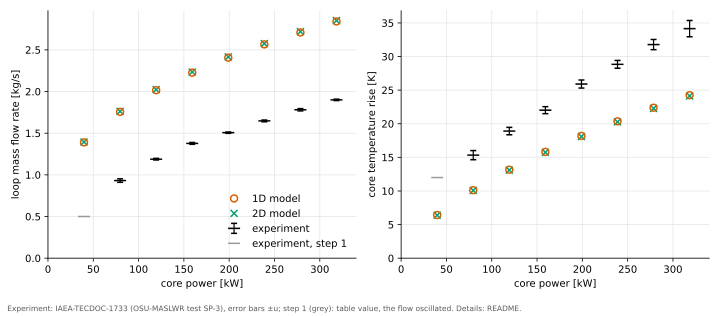

# OSU-MASLWR SP-3: natural circulation in GeN-Foam

Two models of the primary loop of the OSU-MASLWR test facility, built with GeN-Foam (the
multi-physics solver of foamForNuclear, on OpenFOAM; here only its thermal hydraulics): one in 1D
and one in 2D. They simulate IAEA test SP-3: single-phase natural circulation at eight core power
steps from 40 to 320 kW (IAEA-TECDOC-1733). Each model computes the loop mass flow rate and the
core temperature rise at each step. Models from my MSc thesis, TU Wien (Atominstitut), Simon Aster.

Both are the GeN-Foam counterpart of my MOOSE THM model of the same loop
(https://github.com/simon-77/msc-thesis-maslwr-sp3-moose) and use its numbers.



## The models

The models are kept simple: six zones (2D: plus the two plena), seven loss coefficients (2D:
six), one heat transfer coefficient.
All numbers are in one file, `model/parameters`, used by both cases.

- **1D** (`model/1d/`): two vertical legs of one cell in cross-section, joined at the top of the
  steam generator (SG) coil and at the core inlet. Hot leg: core, lower riser, upper riser. Cold
  leg: SG coil, upper and lower downcomer. Each zone is a porous medium with its flow area of
  TECDOC-1733 Table 2-1; the cone between the lower and the upper part is one step at its
  mid-height.
- **2D** (`model/2d/`): the vessel as a body of revolution, a wedge of 2 degrees. The riser has
  its radii from the flow areas of Table 2-1, with the cone. The core, the SG coil and the
  downcomer are porous zones with the flow areas of Table 2-1 (the riser wall has no thickness
  in the mesh). The two plena are open water: the flow that turns in them is computed, so there
  is no loss coefficient at the riser outlet. Turbulence: the k-epsilon model of GeN-Foam for
  porous media, as in its 2D_FFTF tutorial but without the `DhStruct` option (with it, a jet
  grew without bound at the core outlet).
- **Core:** uniform heating, the nominal power of each step (steps of 39.8 kW).
- **Steam generator:** primary side only. The inner surface of the tubes is held at the
  saturation temperature of the measured steam pressure of each step (step 8: the value of
  step 7); the heat transfer coefficient covers the water outside the tubes and the tube wall.
- **Water:** IAPWS-IF97 (liquid) at 8.718 MPa, as polynomials in the temperature, `model/water`.
- **Convection:** first order (upwind), as in the GeN-Foam tutorials.

| coefficient | form | source |
|---|---|---|
| wall friction | Blasius, smooth wall, from the local Reynolds number; 0.02 on the SG shell | built into GeN-Foam |
| flow plate below the core | entrance and sudden expansion | Idelchik 1989 |
| grid wires | screen of round wires | Idelchik 1989 |
| rods in the lower plenum | cross flow through the rod lattice, row by row | Idelchik 1996, Eq. 12-14 |
| core outlet, flowmeter | sudden expansion and contraction | Idelchik 1989 |
| riser outlet (1D only) | velocity head lost | |
| SG bundle drag | Gaddis, in-line tube bank, the same loss for each of the 46 rows | VDI Heat Atlas, L1.4 |
| SG heat transfer | Žukauskas, in-line tube bank, and the tube wall | Žukauskas 1972 |

**Not modelled:** the SG secondary side (so no steam superheat), heat losses to the
surroundings, heat flow through the riser wall, the heat stored in walls and heater rods, the
smaller pressure losses (supports, cones, turns in the plena of the 1D model).
**Nothing is tuned to the measured data or to the MOOSE model.**

**Accuracy and main uncertainties:**
- At steps 2 to 8 both models give a flow 1.5 to 1.9 times and a core temperature rise 0.65 to
  0.72 times the measured one.
- Mesh, 1D (step 5): the flow is 1.7 % higher with 20 cells per metre than with the 80 used,
  and 0.3 % lower with 160.
- Mesh, 2D (step 5): 40 cells per metre along the vessel. The flow is 0.6 % higher with 20 and
  0.5 % lower with 80, so it is not yet independent of the mesh (about 1 % from 20 to 80).
  Twice the cells across the vessel change it by less than 0.1 %.
- The loss of the rods in the lower plenum (about a tenth of the loop's pressure loss) is the
  least certain coefficient. The SG heat transfer coefficient is the value at mid power. Both
  are discussed in the README of the MOOSE THM model.
- The transient: after each power step the flow rises up to 7 % above its later steady value;
  whether this is physical was not investigated. At the end of each plateau the flow equals the
  steady run within 0.05 %.

## Experiment data

`experiment/sp3_experiment.csv`: per step the nominal power, the steam pressure, the loop flow
and the core temperature rise, from TECDOC-1733. For steps 2 to 8 the flow and temperature rise
are means over the last 300 s of each step, digitised from Figs. 4-44, 4-48 and 4-49, with an
uncertainty u from the spread over that window and the reading error (error bars ±u). Step 1 is
a table value: the flow did not settle during that step. During step 5 the operators raised the
feedwater flow and injected cold water into the lower plenum (2896–3428 s, TECDOC-1733 §4); the
loop settled about 30 K colder before the step-5 window.

## How to run

**Files.** `model/1d/` and `model/2d/` are complete GeN-Foam cases in the usual OpenFOAM layout:
`0/` the start and boundary values, `constant/` the physics (`fluid/phaseProperties`: zones,
loss coefficients, heater and SG), `system/` the mesh (`fluid/blockMeshDict`) and the numerics.
`run.sh` copies a case to `runs/` with `model/parameters` (all numbers), `model/water` (made by
`model/make_water.py`) and the inputs of the step from `model/steps.csv`.

Needs Linux with Docker, bash and Python 3.11 or later (`pip install -r requirements.txt`, e.g. in
a venv). GeN-Foam runs in a Docker image that is built once from `docker/Dockerfile` (OpenFOAM
v2606 and foamForNuclear at a pinned commit, from source):

```
docker build -t genfoam:local docker/
./run.sh 1d steady              # the 8 steps at once, 3000 s each (about 50 min)
./run.sh 2d steady              # the same in 2D (about 4 h)
python3 scripts/extract.py 1d   # runs/ -> results/1d/*.csv, with a check of the energy balance
python3 scripts/extract.py 2d
python3 scripts/plot.py         # results/*.svg
```

`./run.sh 1d transient` (or `2d`) runs the SP-3 power history (TECDOC-1733 Table 3-9) in one
run, after a start-up of 2000 s at the first power: 2000 s in the results is the start of the
test in TECDOC-1733. It runs until 6000 s of the test, where the measured curves end (Figs. 4-44
to 4-49). 1D takes about 1 h, 2D about 7.5 h. A 2D run starts laminar; the turbulence model is
switched on after 100 s, with a five times smaller time step for the next 100 s. This is a
workaround: from water at rest the model diverges, because in the porous zones the turbulence
model removes turbulence only in proportion to the velocity. The inputs of each step (power, SG
secondary temperature) are in `model/steps.csv`. A run uses one core; `JOBS` sets how many
steady runs go at a time (default 8).

## Results

- `results/1d/steady.csv`, `results/2d/steady.csv`: end state of each step.
- `results/1d/transient.csv`, `results/2d/transient.csv`: the transient every 10 s and at the end
  of each power plateau.
- `results/2d/fields.csv`: temperature and velocity in every cell of the 2D model at step 5.
- `results/steady.svg`, `results/transient.svg`, `results/2d/fields.svg`.

## Sources

- C. Fiorina, I. Clifford, S. Kelm, S. Lorenzi, On the development of multi-physics tools for
  nuclear reactor analysis based on OpenFOAM: state of the art, lessons learned and
  perspectives, *Nucl. Eng. Des.* 387 (2022) 111604. Code:
  https://gitlab.com/foamForNuclear/foamForNuclear
- IAEA, *Evaluation of Advanced Thermohydraulic System Codes for Design and Safety Analysis of
  Integral Type Reactors*, IAEA-TECDOC-1733, Vienna, 2014.
- A. Žukauskas, Heat transfer from tubes in crossflow, *Advances in Heat Transfer* 8 (1972)
  93–160.
- I. E. Idelchik, *Flow Resistance: A Design Guide for Engineers*, Taylor & Francis, 1989.
- I. E. Idelchik, *Handbook of Hydraulic Resistance*, 3rd ed., Begell House, 1996.
- VDI e.V. (ed.), *VDI Heat Atlas*, 2nd ed., Springer, 2010.
- U.S. NRC, *TRACE V5.0 Theory Manual*, 2016 (thermal conductivity of the tube steel).
- IAPWS R7-97(2012) (IF97), R12-08 (viscosity), R15-11 (thermal conductivity).

## Licence

Code: GNU GPL v3 or later (`LICENSE`). Model results in `results/`: CC BY-SA 4.0
(`results/LICENSE`). The experiment values come from IAEA-TECDOC-1733 and are cited, not
licensed here. To cite the models, see `CITATION.cff`.

## Use of AI

The models were developed with the help of the AI coding tool Claude Code (Anthropic, with
the models Claude Opus 5.5 and Claude Fable 5.2). The work was initiated and directed by me.
The AI was used under my supervision as an aid in writing the cases, the scripts and this
README. The results in `results/` are output of the GeN-Foam simulations, not of the AI. All
content was reviewed by me, and the responsibility for it is mine.
